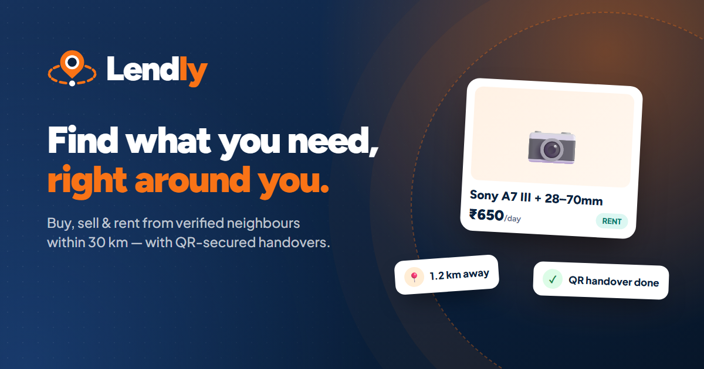
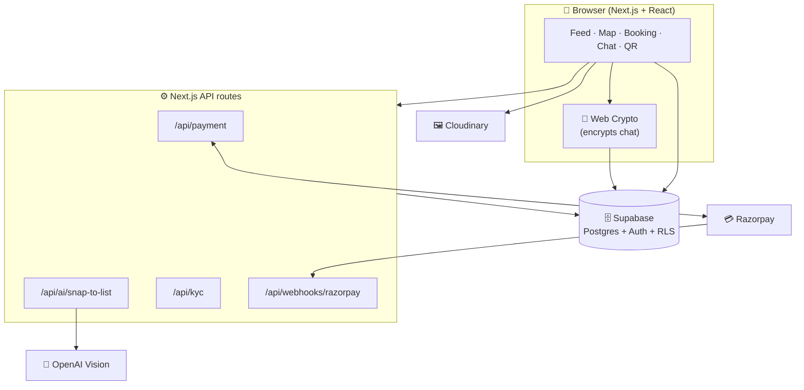

<div align="center">



<br />

# 🧡 Lendly

### *Why buy it, when your neighbour already owns it?*

**A hyperlocal rental marketplace that turns the things gathering dust in one home<br/>into the exact thing someone two streets away needs — today.**

<br />

[](https://nextjs.org/)
[](https://react.dev/)
[](https://www.typescriptlang.org/)
[](https://tailwindcss.com/)
<br />
[](https://supabase.com/)
[](https://razorpay.com/)
[](https://cloudinary.com/)
[](https://platform.openai.com/)
[](https://leafletjs.com/)

[**The Story**](#-chapter-1--the-problem) · [**The Idea**](#-chapter-2--the-idea) · [**Features**](#-chapter-3--how-lendly-works) · [**Tech Stack**](#%EF%B8%8F-chapter-4--under-the-hood) · [**Run It**](#-chapter-5--run-it-yourself)

</div>

<br />

> [!TIP]
> **TL;DR — Project overview**
>
> **What it does:** Lendly lets people rent everyday things — cameras, speakers, projectors, party gear, tools, event essentials — from verified neighbours and local shops within a few kilometres, and book, pay, chat and hand over the item all in one app.
>
> **The problem it solves:** Students and local communities keep buying expensive things they need for a day or a weekend, while identical items sit unused nearby. There's no trusted, local, fast way to borrow from strangers. Lendly adds the missing trust (ID-verified lenders, QR-secured handovers, refundable deposits, secure payments) and the missing proximity (map- and radius-based discovery), so renting next door becomes easier than buying online.

---

## 📖 Chapter 1 — The Problem

It's Friday, 9 PM.

**Ananya** is a second-year student. Her club's cultural fest is on Sunday and she's just been told she's in charge of photography. She doesn't own a camera. A new one costs ₹1,20,000. Online rental sites want a week's notice, a hefty deposit and a courier that may or may not show up.

Meanwhile, **1.2 km away**, a guy named **Rahul** has a Sony A7 III sitting in a drawer. He used it twice last year.

And around the corner, a small shop has a **JBL PartyBox** and **two ring lights** that nobody has rented this month.

Ananya will probably end up borrowing a phone. Rahul's camera will stay in the drawer. The shop's speaker will keep gathering dust.

> **Everything Ananya needs already exists within walking distance. She just can't see it — and even if she could, she has no reason to trust a stranger with ₹1 lakh of gear.**

That gap — between *what's nearby* and *what's reachable* — is the problem Lendly was built to close.

---

## 💡 Chapter 2 — The Idea

What if the whole neighbourhood worked like one shared cupboard?

Lendly is built on three simple beliefs:

| | Belief | What it means in the app |
|:-:|:--|:--|
| 📍 | **Close beats cheap** | Everything is ranked by distance. You set a radius; you see what's around you — on a feed or on a live map. |
| 🛡️ | **Trust has to be designed in** | Lenders verify their identity before listing. Every rental carries a refundable deposit, is paid through Razorpay, and changes hands with a QR scan. |
| ⚡ | **Listing must take seconds, not minutes** | Snap a photo and AI fills in the listing for you. If listing feels like work, nobody lends. |

Lendly is **rentals-only** by design. It isn't another place to sell old stuff — it's a way to get *more use* out of things that already exist, which is cheaper for renters, earns money for lenders, and keeps a lot of single-use purchases out of landfills.

---

## 🚀 Chapter 3 — How Lendly Works

Let's replay Ananya's Friday night — this time with Lendly.

```mermaid
flowchart LR
    A["📷 Rahul snaps a photo<br/>of his camera"] --> B["🤖 AI drafts the listing<br/>title · specs · price"]
    B --> C["🪪 Rahul is ID-verified<br/>listing goes live"]
    C --> D["📍 Ananya finds it<br/>1.2 km away on the map"]
    D --> E["📅 Picks dates &<br/>pays via Razorpay"]
    E --> F["💬 Encrypted chat<br/>to plan the pickup"]
    F --> G["🔳 QR scan at handover<br/>& at return"]
    G --> H["⭐ Deposit refunded,<br/>both rate each other"]
```



### 🧭 For the renter

- **📍 Hyperlocal discovery** — a location-aware feed and an interactive **Leaflet map** show what's available around you, sorted by distance, within the radius you choose.
- **🔎 Search, categories & filters** — browse by category rail or search; filter by price, distance and availability.
- **📅 Availability calendar** — see exactly which days an item is free and book hourly or daily.
- **🎉 Plan an Event** — tell Lendly the date, duration and guest count, and it assembles a full kit (sound, lighting, seating, décor…) from nearby rentals with a live cost estimate.
- **🖨️ Print & Xerox** — upload a document and send it to a nearby print shop, paid in-app.
- **🏪 Local shops** — verified shopfronts with store hours, location and only the stock that fits their speciality.
- **❤️ Saved items, recently viewed & notifications** to pick up where you left off.

### 🤝 For the lender

- **✨ Snap to List (AI)** — take a photo of the item, and a vision model drafts the title, category, condition, specs and description. Or type a brand and model name and Lendly looks up the official specs. Lenders just review and publish.
- **🪪 Identity verification (KYC)** — Aadhaar / ID / PAN details plus an ID photo and a live selfie, encrypted at rest and reviewed by an admin before a lender can list.
- **🏬 Shop onboarding** — a multi-step setup for local businesses with store category, hours and a pinned location.
- **📊 Seller dashboard** — manage listings, bookings and a public seller profile with ratings.

### 🔐 Trust & safety, built in

- **💳 Razorpay checkout** with server-side signature verification, webhooks and refunds.
- **🔳 QR-secured handovers** — the renter shows a QR, the lender scans it at pickup and return, so every handover is recorded.
- **🛡️ Refundable security deposits** on every rental.
- **💬 End-to-end encrypted chat** — messages are encrypted in the browser with AES-GCM-256 (Web Crypto API) before they ever reach the database.
- **🚩 Report a listing** and an **admin panel** for KYC review.
- **🗝️ No login wall** — anyone can browse freely; Lendly only asks you to sign in when you book, list, chat or save.

### 🌏 Made for India

- **5 languages:** English, हिन्दी, മലയാളം, தமிழ், ಕನ್ನಡ
- Prices in **₹**, UPI-friendly payments via Razorpay
- **Mobile-first** design with bottom sheets and a desktop sidebar layout — installable as a PWA

---

## 🛠️ Chapter 4 — Under the Hood

Lendly is a full-stack **Next.js 16 (App Router)** application written in **TypeScript**, backed by **Supabase**.

| Layer | Technology | Why we chose it |
| :--- | :--- | :--- |
| **Framework** | [Next.js 16](https://nextjs.org/) (App Router) + [React 19](https://react.dev/) | Server routes for payments, AI and KYC live next to the UI; fast, SEO-friendly pages |
| **Language** | [TypeScript 5](https://www.typescriptlang.org/) | Type safety across UI, API routes and database models |
| **Styling** | [Tailwind CSS v4](https://tailwindcss.com/) + CSS variables | A consistent design system that's quick to iterate on |
| **Database & Auth** | [Supabase](https://supabase.com/) (PostgreSQL, Auth, Storage, Row-Level Security) | Relational data for bookings and orders, with security enforced in the database itself |
| **Payments** | [Razorpay](https://razorpay.com/) | India-first payments (UPI, cards, wallets) with webhooks and refunds |
| **AI** | [OpenAI](https://platform.openai.com/) vision models | *Snap to List* — turns a photo or model name into a structured listing draft |
| **Media** | [Cloudinary](https://cloudinary.com/) | Signed uploads, automatic image optimisation |
| **Maps** | [Leaflet](https://leafletjs.com/) + React-Leaflet, OpenStreetMap tiles | Free, open map view and location picker |
| **Handover** | `qrcode.react` + `html5-qrcode` | Generate and scan QR codes right in the browser |
| **Security** | Web Crypto API (AES-GCM-256, PBKDF2) | End-to-end encrypted chat and encrypted KYC data |
| **UX** | Lucide icons, react-hot-toast, date-fns | Clean icons, friendly feedback, reliable date maths |
| **Deployment** | [Vercel](https://vercel.com/) | Zero-config hosting for Next.js |

### 🏗️ Architecture at a glance



### 📂 Project structure

```text
├── app/
│   ├── (main)/           # The app itself
│   │   ├── home/         # Local feed of nearby rentals
│   │   ├── explore/      # Map-based discovery
│   │   ├── search/       # Search results
│   │   ├── product/      # Item detail, availability & booking
│   │   ├── plan/         # Plan-an-Event kit builder
│   │   ├── print/        # Print & Xerox orders
│   │   ├── chat/         # End-to-end encrypted messaging
│   │   ├── qr/ · scan/   # QR handover generation & scanning
│   │   ├── sell/         # Lender onboarding, KYC, shop setup, listings
│   │   ├── seller/       # Public seller profile & dashboard
│   │   ├── shops/        # Verified local shops
│   │   └── profile/      # Orders, saved items, settings
│   ├── admin/kyc/        # Admin review of lender verifications
│   ├── api/              # payment · ai · kyc · cloudinary · webhooks
│   └── login/ register/ onboarding/ auth/
├── components/           # market · product · listing · kyc · ui
├── lib/                  # Supabase client, booking logic, crypto, i18n, AI
├── public/               # Logos, icons, demo images
└── supabase/             # SQL schema, RLS policies & demo seed
```

---

## 🧪 Chapter 5 — Run It Yourself

### 1. Clone & install

```bash
git clone https://github.com/karthik-git-pixel/LENDLY-WEBSITE.git
cd LENDLY-WEBSITE
npm install
```

### 2. Configure environment

```bash
cp .env.example .env.local
```

<details>
<summary><b>📋 Click to see all environment variables</b></summary>

```env
# Supabase (Project Settings → API)
NEXT_PUBLIC_SUPABASE_URL=https://your-project-id.supabase.co
NEXT_PUBLIC_SUPABASE_ANON_KEY=your-supabase-anon-key
SUPABASE_SERVICE_ROLE_KEY=your-supabase-service-role-key

# App URL
NEXT_PUBLIC_APP_URL=http://localhost:3000

# Cloudinary
NEXT_PUBLIC_CLOUDINARY_CLOUD_NAME=your_cloudinary_cloud_name
CLOUDINARY_API_KEY=your_cloudinary_api_key
CLOUDINARY_API_SECRET=your_cloudinary_api_secret

# Razorpay
NEXT_PUBLIC_RAZORPAY_KEY_ID=your_razorpay_key_id
RAZORPAY_KEY_SECRET=your_razorpay_key_secret

# AI auto-fill on the listing form (photo → details, model name → specs)
# Without a key the AI buttons show an error; AI_MOCK=true returns a sample draft
OPENAI_API_KEY=
# OPENAI_SNAP_MODEL=
# AI_MOCK=true

# Lender identity verification (required in production — encrypts Aadhaar, ID and PAN numbers)
KYC_ENCRYPTION_KEY=a-long-random-secret
# Verification runs in prototype mode (any details accepted) unless this is true
NEXT_PUBLIC_KYC_STRICT=false
# Optional: restrict the admin verification API to these emails
ADMIN_EMAILS=you@example.com

# Optional: map tiles (defaults to OpenStreetMap, no key needed)
NEXT_PUBLIC_MAP_TILE_URL=https://tile.openstreetmap.org/{z}/{x}/{y}.png
NEXT_PUBLIC_MAP_TILE_ATTRIBUTION=&copy; OpenStreetMap contributors
```

</details>

### 3. Set up the database

In the Supabase SQL Editor, run:

1. `supabase/schema.sql` — tables, functions and Row-Level Security policies
2. `supabase/seed-demo.sql` — *(optional)* demo categories, shops and listings

To review lender verifications, make your account an admin and open `/admin/kyc`:

```sql
UPDATE public.profiles SET is_admin = TRUE WHERE email = 'you@example.com';
```

### 4. Launch

```bash
npm run dev
```

Open **[http://localhost:3000](http://localhost:3000)** — and go find something nearby. 🎉

---

## 🌱 Epilogue — What's Next

Ananya got her camera. The fest photos turned out great. Rahul made ₹1,300 from a drawer. 📸

Next on the roadmap:

- 🧾 Damage protection & insurance options for high-value rentals
- 🏫 Campus communities — rentals visible only within a college network
- 📈 Smart pricing suggestions based on local demand
- 📲 Native mobile apps with push notifications

---

<div align="center">

### Built with 🧡 to make every neighbourhood a little more connected.

**Lendly** — *Find what you need, right around you.*

⭐ **If you like the idea, give the repo a star!** ⭐

<sub>Distributed under the MIT License.</sub>

</div>
